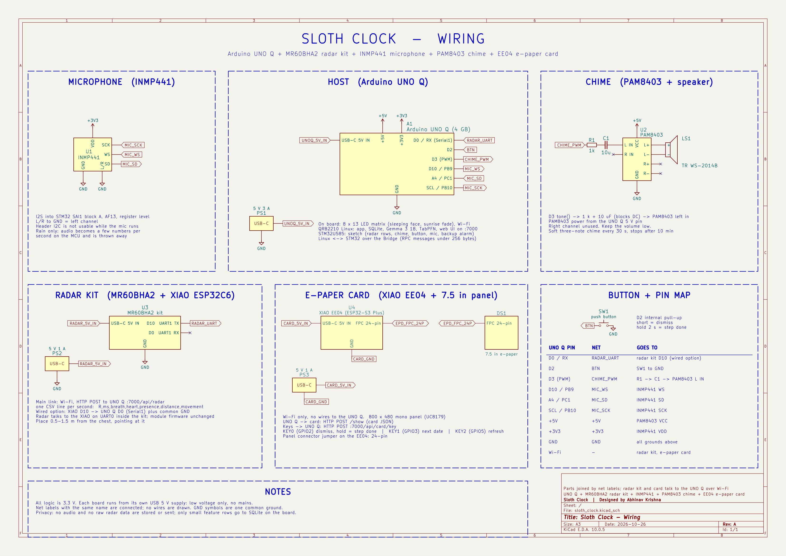

# Sloth Clock 🦥

**Slow and steady wins the morning.**

Most alarm clocks punish you for being tired. Sloth Clock does the opposite: it watches how you slept, and
if the night was rough, it lets you sleep in, safely. Then it asks for the smallest possible step on the job
you keep putting off. Not the whole job. One tiny step.

Laziness, done properly, is a strategy. Rest when you need it, move a little every day, never panic.
That is how a sloth gets where it is going.

Everything runs offline on one Arduino UNO Q. No cloud, no account, no camera, no wearable.

## The three lazy things it does for you

### 1. It lets you sleep in, and it earns that right
A 60 GHz mmWave radar on the nightstand reads breathing, heart rate and restlessness through the blanket.
In the morning the board scores the night. A bad night or a rainy morning buys up to **30 extra minutes**,
never past your "must be up by" time. You wake to a slow sunrise on the LED matrix and a soft chime, and a
short note tells you why: "Restless night, so I gave you 15 more minutes."

The extra sleep is a reward with rules, not a free pass:
- never more than +30 minutes
- never past the hard limit you set
- no snooze, ever
- no sleeping in two days in a row, unless the night was very poor

These limits are hard-coded and tested. The language model only writes the wording; it never decides the time.

### 2. It remembers so you don't have to
A no-glow 7.5" e-paper card sits on the nightstand showing tomorrow's alarm and the next few important dates,
with countdowns worked out in code ("In 3 days"). E-paper holds its picture with no power, so it doesn't light
up the room. Three buttons: dismiss, next date, mark today's step done.

### 3. One tiny step a day
Type in the job you keep avoiding ("file taxes"). The local model splits its first step into three sizes:
tiny (5 min), small (15 min) and normal (30 min). Each morning the clock picks one:
- after a poor night: the tiniest step
- after a good night: a little more
- once 20 mornings are logged: a small predictor learns which step size you *actually* finish, and picks the
  biggest one you are likely to do

Small wins, every day, without guilt. Slow and steady.

## Honest by design
- **It says "not sure".** Too little radar data? It keeps your normal alarm and shows the tiniest step.
- **Every number the model writes is checked.** Gemma 3 1B writes the friendly message, and a validator
  rejects any time, number or claim that isn't in the decision record. If the model fails twice, a template is used.
- **A backup alarm.** The real-time microcontroller rings on its own if the Linux side ever misses the alarm.

## Privacy
No audio or raw radar data is stored or sent anywhere. The microphone (used only to recognise rain) is turned
into a few numbers per second on the microcontroller, and the audio itself is thrown away. Only small feature
rows and events are kept, in SQLite on the board.

## Status
All features are built. Measured results: `docs/measurements.md`. Progress: `docs/progress.md`.

| Part | State |
|---|---|
| Radar logging, night score, alarm decision with health limits, LED-matrix sunrise, chime, wake message + validator, demo mode | running on the board; radar about 80-90% against a manual breath count and a reference heart rate |
| E-paper card, dates and jobs, tiny-step engine (Gemma steps + TabPFN size) | running on the board |
| Rain (microphone features + classifier) | running on the board: rain bonus (+15 min) tested |
| Step-size predictor | TabPFN v2 on the board (CPU, offline after a one-time weights download); numpy logistic regression for rain and as fallback |

## Hardware
- Arduino UNO Q (4 GB)
- Seeed MR60BHA2 60 GHz mmWave breathing & heartbeat sensor (on its XIAO ESP32C6 kit)
- Seeed XIAO ePaper Display Board EE04 + 7.5" monochrome e-paper (800×480)
- INMP441 I2S microphone (rain detection)
- PAM8403 amplifier + small cavity speaker (chime, on D3)
- Push button (D2)

## How it works
```
radar kit (XIAO ESP32C6) --UART-----------------> STM32U585 (sketch)  --Bridge--> Linux (Python app) --Wi-Fi--> e-paper card
INMP441 mic -------------SAI-----------------------> radar rows, mic features,       SQLite, night score,          (EE04)
                                                     LED-matrix sunrise, chime,      alarm decision, tiny steps,
                                                     button, backup alarm            Gemma 3 1B + validator, web UI
```
- **Radar kit:** wired to the board. It sends one line per second on a UART (XIAO D10 to UNO Q D0, shared GND)
  to the STM32 parser.
- **STM32 (real time):** radar lines, rain sound features (hand-written FFT), LED-matrix face and sunrise,
  chime (tone on D3 -> PAM8403 -> speaker), button, backup alarm.
- **Linux (same board):** night score, alarm decision with hard health limits, rain detection, tiny-step engine,
  step-size predictor, Gemma 3 1B via llama.cpp, web page on port 7000, e-paper updates.

## Wiring


## Repository
- `app/`: the Arduino App Lab app (`sketch/` for the STM32, `python/` for Linux, `assets/` for the web page)
- `firmware/radar_forwarder/`: radar kit forwarder (UART to the UNO Q)
- `firmware/epaper_card/`: e-paper card (copy `secrets.example.h` to `secrets.h`)
- `tests/`: decision, validator, night score, steps and rain tests (`python tests/test_*.py`)
- `hardware/`: wiring schematic (KiCad, PDF, PNG)
- `docs/`: measurements and progress

## Safety
Low voltage (USB) only. No mains wiring, no heat, no moving parts. This is a comfort device, not a medical one.

## Credits
llama.cpp, Gemma 3 (Google), Seeed mmWave and Seeed_GFX libraries, ArduinoJson, numpy.
Built with TabPFN: the step-size predictor uses TabPFN v2 by Prior Labs (`tabpfn==2.2.1`, Prior Labs License:
Apache 2.0 with an attribution clause). Usage telemetry is switched off (`TABPFN_DISABLE_TELEMETRY=1`).

## License
MIT

## Note on late changes
The commit "Final polish and bug fixes" (2026-10-27) was made after the deadline (2026-10-26, 12:29 IST).
Everything up to "Reword README status" (2026-10-26, 12:28 IST) was in place before it.
